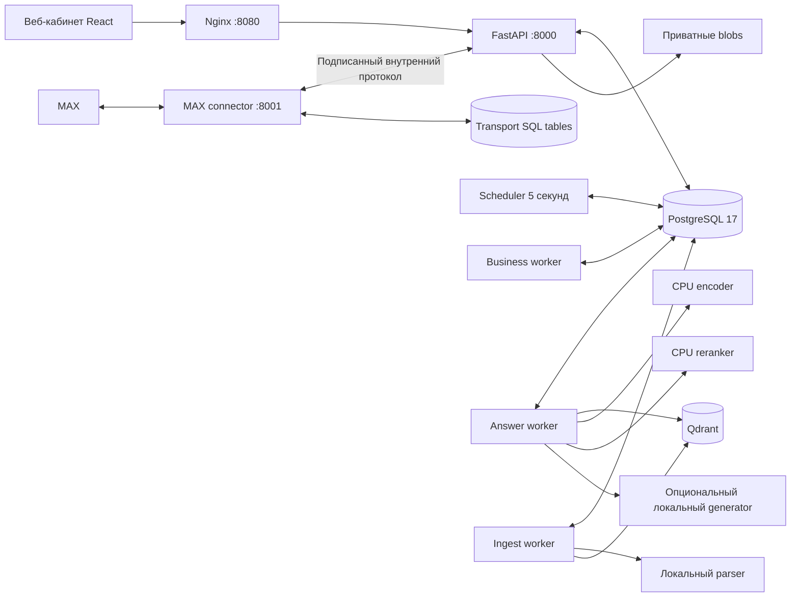

# Корсик: фактическая архитектура приложения

Состояние исполняемой реализации на 24.10.2026. Точный образ каждого измерения указан в его отчёте; изменение документации не переименовывает прежний прогон в проверку нового образа. Исторические проектные решения находятся в `../korsik-spec/`; фактический API задают код FastAPI, `/api/docs` и генерируемый `openapi.json`. Инженерный тест не равен приёмке компанией: границы доказательств перечислены в `tests/requirements-coverage.csv` и отдельных JSON-отчётах.

Описание относится к рабочей версии проекта. Запуск и восстановление описаны в [OPERATIONS.md](OPERATIONS.md).

## Что делает продукт

Сотрудник получает программу адаптации в MAX, общается свободным текстом, задаёт вопросы кнопками, отвечает на анкеты и передаёт проблему HR. HR управляет справочником, документами, сценариями и отдельным меню вопросов через веб-кабинет. Руководитель работает с операционными статусами своей команды и явно назначенными ему задачами. Руководитель подбора получает агрегаты; персональный drilldown выдаётся отдельным разрешением.

Сценарный движок определяет сроки, переходы, обязательные действия и кадровые решения. LLM формулирует только ответ по разрешённым источникам. Она не исполняет инструкции из документов, не запускает код, не меняет роли, календарь, анкету или карточку сотрудника.

## Компоненты Compose

| Компонент | Реальное назначение |
| --- | --- |
| `frontend/` | React/TypeScript, нативные формы HR, canvas сценария, чат, анкеты, KB review, аналитика, настройки. Сборка отдается Nginx. |
| `api` | FastAPI, local session auth, CSRF, ETag и идемпотентные команды, объектная авторизация, HTTP API и внутренний транспортный контракт. |
| `worker` | MAX inbox, business events, отложенные подтверждения HR-стадии, уведомления, dashboard materialization, анализ отзывов и вспомогательные задачи. |
| `answer-worker` | Отдельная очередь `ANSWER`: запрос к локальному retrieval/generation не занимает business worker. |
| `ingest-worker` | Парсинг, candidate build, QA, публикации, rollback/purge документов и длительная `LOCAL_AI_VALIDATE`; реальная модельная validation не занимает business worker. |
| `scheduler` | Durable сроки/напоминания/SLA/повторения/digest, watchdog lease/deadline, подготовка доставки; default tick 5 секунд. |
| `max-connector` | Единственный адаптер MAX и разрешённый messenger egress. Получает входящие события, скачивает вложения в staging, отправляет разрешённый core envelope. |
| `postgres` | Авторитетные бизнес-состояния, сообщения, очереди, транзакции и история. Compose использует `postgres:17-alpine`. |
| `qdrant` | Восстанавливаемая dense+sparse проекция опубликованных KB chunks; Compose закрепляет `v1.20.0`. |
| `parser` | Локальный PDF/PPTX/image/text parser, OCR и структурный разбор. Ни SQL-пароля, ни доступа к внешней генерации у него нет. |
| `encoder`, `reranker` | Локальные ONNX FP32 CPU endpoints. |
| `generator` | Локальный CUDA decoder в FULL. В CORE сервис не нужен. |
| `tunnel` | Временный HTTPS Quick Tunnel демонстрационного стенда. В `deploy/compose.onprem.yaml` выключен; в компании его заменяет собственный reverse proxy. |

Redis, Airflow, n8n, внешняя LLM API, SSO/OIDC в поставке не развёрнуты. Расписание и конструктор работают без них.

## Модули backend

| Файлы `backend/korsik/` | Ответственность |
| --- | --- |
| `main.py`, `settings.py`, `db.py`, `migrations.py` | HTTP middleware, ограничения очереди, runtime configuration, SQL connections/migrations и provisioning SQL-ролей. |
| `auth.py`, `auth_admin.py`, `common.py` | Пароли/sessions/CSRF, управление учётными записями/reset, scopes, ETag, audit, durable enqueue/outbox helpers. |
| `domain.py`, `employment_stages.py`, `scenario_engine.py`, `seed.py` | Справочник/периоды найма, lifecycle и durable HR-stage commands, граф программы, рабочие календари, анкеты/captures, cases/tasks/blockers/gaps, меню, отчёты/digests. `seed.py` хранит исходное сопоставление Excel. |
| `max_miniapp.py` | Проверка подписанного launch MAX, обмен на session/CSRF, replay fence и проверка актуальности binding/episode на каждом запросе. |
| `survey_campaigns.py` | Версии добровольных identified опросов, audience preview/CAS, durable delivery/reminders, scoped HR ответы и агрегаты малых групп. |
| `runtime_health.py` | Атомарный container heartbeat для workers/scheduler; host recovery находится в `scripts/runtime-watchdog.py`. |
| `chat.py`, `max_events.py` | Канонический диалог текущего периода, свободные сообщения/кнопки, handoff/HR reply/resume, разбор MAX updates и подтверждённая привязка. |
| `transport_api.py`, `max_connector.py` | Предпроверки доставки, opaque signed callbacks, attempt leases/receipts и внешние MAX вызовы. |
| `knowledge.py`, `knowledge_admin.py`, `knowledge_warnings.py`, `knowledge_ownership.py` | Документы/редакции/extraction, ответственные HR, структурный diff, HR review, candidate snapshots, контрольные вопросы/QA, зависимости/impact, publish/archive/rollback/purge и явные предупреждения. |
| `parsing.py`, `services/model_server/parser_app.py` | Физические страницы, блоки/таблицы/картинки, OCR/структурный parser, NDJSON checkpoints и выборочный OCR retry/rotation. |
| `retrieval.py`, `rag_identity.py`, `assets.py`, `recovery.py` | Разрешённый поиск/контекст/локальный ответ, версии и хэши исполняемого pipeline/request/renderer, приватные citations/страницы/файлы, rebuild Qdrant из SQL. |
| `analysis.py`, `local_ai.py` | Локальный baseline анализа отзывов и immutable HR corrections; реестр моделей, конфигурации профилей, реальная validation и активация. |
| `worker.py`, `scheduler.py`, `operations.py`, `manage.py` | Executors/watchdogs, техническое состояние, integration/retention controls и CLI оператора. |

## Физическое хранение и логические агрегаты

Схема намеренно компактна. Это **не** отдельная SQL-таблица на каждый объект из проектной ER-модели. `models.py` содержит типизированные таблицы `users`, `sessions`, `jobs`, `outbox`, `messages`, `audit_events`, `idempotency_records`, `transport_inbox`, `transport_deliveries`, `transport_cursors` и универсальную `domain_entities`.

`domain_entities` хранит `kind`, `parent_id`, `owner_id`, `status`, JSON `data`, optimistic `version` и timestamps. В JSON находятся версии графов/анкет, snapshots, содержательные pins и исторические события. Логические ссылки проверяет сервер; все JSON ссылки не обеспечены внешними ключами PostgreSQL. Важные переходы дополнительно используют `FOR UPDATE`, свежую загрузку состояния, ETag и advisory locks. Изменение вложенного JSON заменяет `data` целиком.

| Группа логических агрегатов | Основные `kind` |
| --- | --- |
| Справочник | `organization`, `site`, `employee`, `employment_episode`, `employee_change`, `max_binding`, приглашения, HR contacts. |
| Адаптация | `scenario`, immutable опубликованные `scenario_version`, `journey`, `scheduled_action`, `journey_event`, `survey_run`, `input_capture`, profile publications. |
| Пользовательские опросы | `survey_template`, `survey_template_version`, `survey_campaign`, `survey_campaign_enrollment`; ответы в существующем `survey_run`. |
| MAX MiniApp | `max_miniapp_launch`, `max_miniapp_session`; актуальные HR-approved bindings и обычная таблица `sessions`. |
| Меню | `assistant_menu`, `assistant_menu_version`; version независима от календарной программы. |
| Работа HR | `conversation`, `answer`, `case`, `case_event`, `manager_task`, `knowledge_gap`, immutable feedback review records. Текстовые сообщения отдельно в `messages`. |
| KB | `document`, `document_revision`, extraction revision/pages/blocks, `knowledge_candidate`, `knowledge_snapshot`, `knowledge_head`, QA/control question/impact/dependency records, `citation`. |
| Аналитика/эксплуатация | dashboard snapshots, notification preferences, digest schedules/occurrences, `operation`/events, model artifacts/profiles/validation, `service_health`, `retention_policy`, private `audit_reason`. |

SQL + immutable blobs являются источником истины. Qdrant можно очистить и восстановить `python -m korsik.manage reindex`. Blob paths не становятся публичными URL. Запрос source/preview и фактическая отправка вложения повторно проверяют доступ.

## Роли и границы доступа

| Роль | Доступ |
| --- | --- |
| `EMPLOYEE` | Собственная карточка/чат/анкеты/ввод только текущего периода найма и разрешённые источники. Новый период не открывает историю прежнего веб-аккаунта. |
| `MANAGER` | Прямые подчинённые и операционные статусы. Явно делегированная задача даёт узкое право на неё, без доступа ко всей карточке, анкете или HR case. |
| `HR_SPECIALIST` | HR функции в текущей разрешённой области, без самостоятельного расширения grant и административной публикации. |
| `HR_ADMIN` | HR администрирование/публикация в своей области. Общеконтурные настройки требуют `scope.all:true`. |
| `HEAD_TALENT` | Разрешённые агрегаты; персональный roster по отдельному `employee_drilldown:true`. Нет raw HR ответов/текстов задач. |
| `PLATFORM_ADMIN` | Техническое состояние/интеграция/модели/очереди. Роль не даёт автоматического права читать документы, переписку и кадровые данные. |

Scope проверяется по текущему состоянию на каждом защищённом действии. Заданные `site_ids` и `legal_entity_ids` применяются совместно. Назначенный HR может получить узкий доступ к карточке; это не право создавать глобальные материалы. Legacy программа без scope считается глобальной. Региональный HR создаёт программу в своей области; применимость проверяется при enrollment, migration/replan и presend.

Callback привязан к серверному opaque action, сотруднику, диалогу, episode, версии меню/вопроса и TTL. Транспорт повторно проверяет текущую MAX-привязку, режим BOT/HUMAN, сроки, источники и attachments непосредственно перед отправкой. OFFBOARD отзывает будущий доступ/сессии/приглашения/callbacks; REHIRE создаёт новый episode и требует новой проверки MAX.

HR может подтвердить PREBOARDING/ACTIVE сейчас либо запланировать стадию. Durable business job хранит UTC due, ожидаемый episode/version/stage и pin роли/области автора. При исполнении заново проверяются lease, включённая HR-учётная запись, текущий доступ и episode. Новая команда, отмена, offboard/rehire и изменившиеся права не позволяют старому job применить стадию. Отложенное увольнение не заявлено: OFFBOARD остаётся немедленным workflow.

## Основные потоки

### Адаптация и конструктор

Исходный seed содержит 68 строк, 28 ONB-групп, 5 исходных анкет и 9 вопросов F64. Дополнительные HR-опросы создаются отдельно в «Опросах» и не заменяют эти исходные анкеты. Не переданные медиа/контакты не подменяются вымышленными материалами. Демо-пятидневка явно задана в seed; для реального подразделения HR подтверждает календарь/смены и покрытие дат.

Основной интерфейс — «Схема» с графом, без пошагового мастера. HR редактирует draft графа: реплики, условия, варианты площадки/обращения, вопросы, файлы и triggers. Drag/drop перед/после/в ветку выполняет semantic rewire, а координаты canvas хранятся отдельно. Validation проверяет достижимость, ссылки, условия, переменные, календарные anchors и разрешённые типы. Simulation показывает виртуальную хронологию. Изменения обязательной исходной логики требуют явного review diff/fingerprint/причины; смена baseline инвалидирует прежний review. Publish закрепляет immutable версию. Действующие journeys сохраняют pin, миграция использует отдельные preview/hash/apply.

Scheduler создаёт устойчивые actions из локальных дат/рабочих интервалов и сигналов. Принятый MAX receipt, а не начало попытки, запускает соответствующие напоминания/переходы. Анкета различает answer/decline/missing, revision вопроса и явное подтверждение завершения. Свободный capture сначала DRAFT и применяется только после подтверждения; обычный вопрос к ассистенту не становится ответом анкеты по догадке модели.

### Свободный диалог и HR

Web/MAX turn фиксируется в SQL с уникальным ключом. `ANSWER` исполняется отдельно; на диалог допускается ограниченное число pending turns. Retrieval получает структурированный профиль сотрудника, stage/площадку/юрлицо и актуальный KB snapshot. Кнопка меню передаёт утверждённый query в тот же поиск; готовый неподконтрольный ответ в меню не хранится.

Если поиск не дал безопасного ответа (`HANDOFF`), worker создаёт/переиспользует case, уведомляет действующего scoped HR и отправляет нейтральное «Вопрос принят. Уточняем информацию; ответ появится здесь.». Диалог остаётся `BOT`, следующий вопрос продолжает поиск. Legacy кнопки отдельного обращения к HR фильтруются транспортом. Только явный claim конкретным HR переводит диалог в `HUMAN`; отдельного сообщения о подключении нет. Ответ человека начинается «Ответ команды поддержки:» и проходит текущие ACL/binding presend. Ручной API handoff с `WAITING_HR` сохраняется отдельно. Возврат к BOT явный. BIO/PHOTO сначала проверяются и публикуются HR с preview конкретных recipients; revoke прекращает будущую доступность, но не обещает стереть уже прочитанное сообщение MAX.

### Документы и локальный RAG

1. Upload создаёт новую непубличную редакцию и durable ingest operation; оригинал/sha сохраняются.
2. PDFium/pdfplumber извлекают нативный текст и физические страницы. Сканы обрабатывает Tesseract `rus+eng`; CPU structural profile добавляет Docling Heron/TableFormer. PPTX читается нативно, LibreOffice даёт preview. Изображения проходят локальный OCR; отсутствующее описание смысловой картинки требует HR review.
3. NDJSON checkpoints сохраняют pages/blocks/ошибки. HR исправляет текст/структуру, проверяет страницу, описывает важную фигуру. Retry выбранных страниц/rotation не стирает прочие физические страницы. Повернутый OCR не смешивает недостоверные координаты Docling.
4. Candidate build фиксирует набор extraction revisions/участников/модели и индексирует кандидатную проекцию. QA исполняет контрольные вопросы; зависимости инструкции требуют точных source block hashes. Предпросмотр кандидата доступен редактору, сотруднику не рассылается.
5. HR review/impact решения закрепляются fingerprints. Atomic publish меняет единый current snapshot; неуспешная/отменённая сборка не меняет действующую БЗ.
6. FULL объединяет dense+sparse Qdrant retrieval и отдельный локальный Snowball BM25 recall, выполняет CPU reranking и parent diversification. Канонический parent здесь — физическая страница с отдельными точными компонентами: нативные TEXT/TABLE и проверенные HR описания FIGURE, привязанные к image hash. Это не гарантированно восстановленный семантический раздел. Для содержательного нормативного результата SQL дополнительно подбирает связанные страницы того же раздела по точному canonical heading и предмету вопроса. Дополнение ограничено текущими разрешёнными revision/extraction либо frozen chunk membership кандидата; ему не приписывается выдуманный reranker score. Более шести требуемых страниц даёт явный `SECTION_CONTEXT_TOO_COMPLEX`/HANDOFF; общий лимит ответа с источниками сохраняется. Заголовок/дата без содержательного текста не становятся самостоятельным доказательством. Нормативные разрешения/запреты, перечисления и отсутствующие приложения имеют отдельные literal/completeness guards. При срабатывании проверки или недоступной генерации выбирается разрешённая выдержка/уточнение/HR. Генерация использует найденные доказательства, но механические проверки не гарантируют обнаружение любой смысловой ошибки: source score и проверка чисел не являются вероятностью правильного кадрового совета.
7. Archive/revoke действует сразу на последующие чтения/историю/citations/presend. Rollback создаёт новую проверяемую редакцию по прежней; purge — отдельная административная операция по утверждённой retention policy.

Документ имеет явного ответственного HR. HR_ADMIN меняет его с ETag и причиной; целевой пользователь должен быть включён, иметь HR-роль и актуальную область записи для предлагаемого scope документа. Совместная смена scope/owner атомарна, изменение scope не оставляет заведомо недоступного ответственного. Владение не создаёт дополнительных прав. Сравнение редакций показывает изменения текста/таблиц, hashes картинок, доступных metadata и явных зависимостей; отсутствие связи не доказывает отсутствие смыслового влияния.

Новые chunks содержат version/fingerprint фактических выбранных функций chunker; прежние без такого pin явно помечаются LEGACY_UNVERSIONED. Ответ хранит current published snapshot membership и идентичность retrieval/guards, точный JSON request SHA, runtime renderer source SHA и rendered prompt SHA, если runtime их сообщил. Наряду с диагностическими AST hashes профиль закрепляет SHA256 всего retrieval module, включая константы и новые helpers. QA и профиль учитывают изменения исполняемого pipeline/runtime source; старый quality-report без соответствующих source hashes не становится новой успешной приёмкой. Эти хэши обеспечивают воспроизводимость происхождения, а не истинность содержания ответа.

### Три дополнительных процесса

| Процесс | Полная цепочка и граница автоматизации |
| --- | --- |
| Вопрос без ответа → пополнение БЗ | `knowledge_gap` → HR owner/triage → обезличенная инструкция с точными source dependencies → candidate/QA/review/publish → закрытие gap ссылкой на действующую опубликованную инструкцию. Непроверенный ответ модели не становится нормой. |
| Помеха работе → подтверждённое устранение | BLOCKER case → ответственный/срок → конкретная resolution attempt → сотрудник подтверждает CONFIRMED либо NOT_FIXED/REOPENED. Молчание и административное закрытие не считаются успехом. |
| Изменение регламента → контроль влияния | Новая редакция → зависимые инструкции/impact review → кандидатный срез и regression QA → атомарная публикация либо сохранение прежней базы. |

## Очереди, доставка, согласованность

`jobs.unique_key`, `outbox.unique_key`, `(conversation_id,seq)` и входящий MAX event ID ограничивают дубли. Worker claim использует `FOR UPDATE SKIP LOCKED`, lease и token; перед commit проверяется актуальный lease. Повторный исполнитель не фиксирует устаревший результат. Scheduler advisory lock предотвращает два одновременных sweep.

Длительные KB операции соблюдают Job → KB advisory lock → operation → отсортированные documents. Checkpoints/финальная материализация проверяют lease/cancel. Model HTTP вызовы не удерживают этот набор блокировок. Cancel разрешён только операциям с реализованным протоколом: ingest, QA, candidate build, report export и отдельный короткий протокол scheduled HR-stage. Purge/rollback не «отменяются» произвольным переводом статуса.

Core создаёт `outbox`, затем минимальный `transport_delivery`. Connector имеет SQL-роль только для transport tables и не читает HR Entity/messages. Core выдаёт envelope после claim/presend; после upload/rate-limit connector делает повторный validate текущего attempt. ACCEPTED receipt идемпотентно записывает platform message ID и создаёт один `OUTBOX_ACCEPTED`. Неопределённый внешний результат становится `UNKNOWN_DELIVERY`, без слепой повторной отправки. Это не обещание exactly-once доставки внешней платформой.

## FULL, CORE и модельный профиль

Все AI endpoints локальны. CPU базовый стек: `ibm-granite/granite-embedding-97m-multilingual-r2` и `Horizon-Labs/multilingual-reranker-small`, pinned ONNX artifacts. Код/default Compose используют `Qwen/Qwen3.5-4B`; каталог также умеет устанавливать 0.8B/2B, но наличие каталога не означает активную модель. Истина — `GENERATOR_MODEL_SUBDIR`, mounted manifest, registry `deployment_selected`, validation и активный local AI profile. 0.8B провалила узкий semantic smoke и не считается качественно принятой.

В FULL decoder локальный, без GigaChat/DeepSeek/Yandex/OpenAI API и скрытого внешнего fallback. Runtime identity/fingerprint должны совпасть с выбранным профилем. Смена directory/model требует операторского перезапуска сервиса, новых реальных tests и активации профиля после drain; горячая подмена весов не реализована. CORE явно ограничен: SQL lexical поиск и approved card/допустимая выдержка/уточнение/HR; Qdrant/encoder/reranker не участвуют в CORE answer path. Сценарии, анкеты и бизнес-записи сохраняются. Недоступная LLM в FULL сохраняет FULL retrieval с явной деградацией генерации; это не утверждение, что получен полноценный LLM ответ.

Намеренное приостановление активного AI профиля после смысловой ошибки отличается от отказа сервиса: READY не доказывает пригодность ответов. Исторический runtime smoke или успешный restart не заменяет новую смысловую проверку на точных источниках и актуальных fingerprints. Восстановление генерации требует совместимого проверенного профиля и явной активации; до этого система показывает безопасный режим, сохраняя сценарии и обращения HR.

Модели/языки OCR/Docling artifacts/образы заранее доставляются в контур. AI/data сети Compose `internal:true`, telemetry/offline flags заданы. Исключение — отдельно разрешённый MAX messenger transport; демонстрационный tunnel также имеет внешний канал. «Без внешних AI API» не означает «MAX работает при физически запрещённом доступе к MAX».

## Аналитика, аудит, проверенные границы

Метрики считает SQL/детерминированный код. API даёт общий IANA period/timezone, numerator/denominator/missing/no_data и frozen export context; дата конца включительна локальному дню и преобразуется в exclusive boundary. Survey cohort определяется принятым opening; topics — временем feedback. Операционные статусы/прогресс явно CURRENT_STATE_AS_OF, не реконструкция прошлого. Средние учитывают только валидные integer ответы. CSV аналитики включает отдельные NUMERIC_AVERAGE строки с текстом вопроса, average и признаком suppression; все ячейки проходят защиту spreadsheet formulas. Чувствительные темы/тональность/средние подавляются при n<5; свои операционные задачи руководителя не скрываются этим правилом.

Weekly digest использует только human-reviewed labels; synthetic baseline sentiment требует HR решения и не доказан на отзывах компании. Dashboard snapshots материализуются фоном; GET не отправляет уведомлений. Уведомления coalesce и требуют собственной подтверждённой MAX-привязки получателя.

Audit хранит автора/время/объект/технические metadata. Переданные человеком причины находятся в private `audit_reason`, technical event содержит opaque ref. Их читает только global HR audit; PLATFORM/HEAD/scoped HR не получают чужие причины. Native human reasons и стандартные `reason_code` различаются. Исчерпывающая корпоративная приёмка каждой формы не подменяется этим механизмом.

Исторически проверенная инженерная поставка source15 использовала backend image `38206fd7…a72c5d8`; frontend WEB18 дополнительно показывает проверяемую MAX-личность и требует осознанного подтверждения HR. Backend suite310PASS+6subtests, frontend23PASS. Доказательства ограничены следующими фактически выполненными наборами:

| Набор | Измеренный результат и граница |
| --- | --- |
| Actual source regression | 29/29:24EXTRACT,2LOCAL_GENERATED,3HANDOFF; полный source/body/pins проверен вручную. Коррелированный набор известных вопросов, без TABLE gold; company acceptance не заявляется. |
| FULL HTTP100 | 100/100COMPLETED,90EXTRACT/10GEN; overallp95 26.0687с, generated-only n10/p95 26.2059с. Warmed single active turn,10тем×10prefixes. |
| CORE HTTP100 | 100/100EXTRACT, HTTPp95 1.0161с; отдельный cold CORE контур с тем же backend image, без decoder/GPU. |
| PostgreSQL | 19 проверок concurrency/fault на PostgreSQL17.11, schema-only/synthetic DB, cleanup0,0MAX/modelHTTP. |
| Offline cold | 15checksPASS, internet DNS/TCPblocked, OCR7.511с, native10/10 и реальные decoder responses, восстановлено81/81Qdrantpoints. Prepared same-host images/models; cleanOS installation не доказана. |
| Изолированные сбои | GeneratorDOWN: business2.119с. Controlled allocatorOOM:6реальных исключений, business1.926с, recovery200; это не физическое исчерпаниеVRAM. ENOSPC1MiB→507 и успешный retry; оба проекта полностью удалены. |

Точные результаты unit/PG concurrency, offline cold restore, OCR, generator failure, ENOSPC и HTTP latency находятся в `tests/*report*.json`. У каждого измерения есть версия/режим/fixture/ограничение. 100 timing prompts не являются 100 независимыми golden вопросами; synthetic OCR и role negatives не заменяют корпоративную оценку OCR/RAG и независимый security review.
