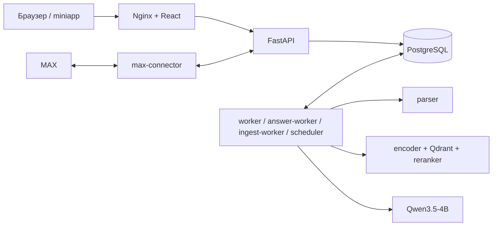
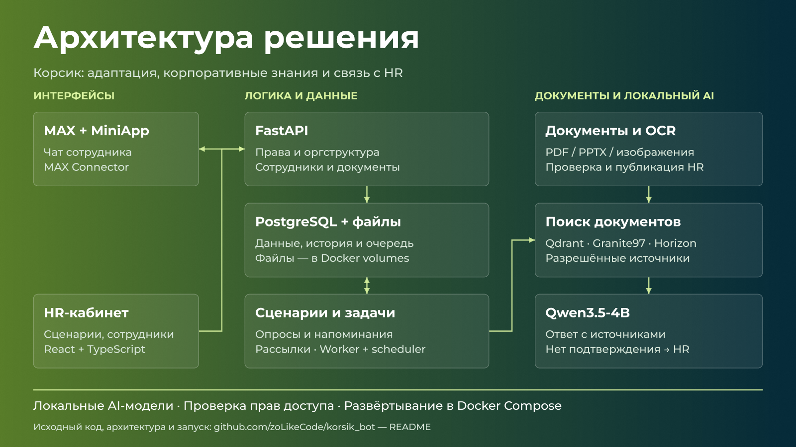

# Корсик

Адаптация сотрудников и HR-кабинет в MAX. Сотрудники проходят сценарии и опросы, задают вопросы по документам. HR управляет сотрудниками, оргструктурой, базой знаний, диалогами и рассылками.

В репозитории — рабочая версия на основе release28 с дашбордами аналитики: backend, frontend, Docker Compose, миграции, начальные данные, тесты и скрипты эксплуатации. Экспериментальные оптимизации в неё не включены.

## Аналитика

В разделе три дашборда: общая картина адаптации, опросы и обратная связь, поддержка и подразделения. Они показывают прохождение программ, завершение анкет, результаты вопросов в исходной шкале, динамику обращений и вопросы, которые ждут ответа HR. Для руководителя по подбору доступны проверенные темы частых проблем.

Фильтры: период, часовой пояс, площадка и подразделение с вложенными отделами. CSV выгружается с теми же фильтрами и правами. Руководитель видит своих подчинённых, HR — свою область ответственности. Учитывается текущий период найма; отключённые и удалённые сотрудники исключаются. Результаты опросов требуют минимум пяти разных участников, личные тексты в сводку не попадают. При отсутствии данных показывается пустое состояние.

Опросы и динамика считаются за выбранный период. Статусы адаптации и нерешённые вопросы показывают состояние на сейчас. Завершение опросов считается от анкет с доставленным первым вопросом; передача обращения HR не считается ответом Корсика.

## Архитектура

| Сервис | Назначение |
| --- | --- |
| `web` | React + TypeScript, Nginx: интерфейс, miniapp и проксирование API |
| `api` | FastAPI: авторизация, права, сотрудники, документы и настройки |
| `postgres` | Основные данные, задания, сценарии, история и очередь сообщений |
| `qdrant` | Векторный индекс опубликованных документов |
| `worker` | Общие фоновые задания |
| `answer-worker` | Поиск по документам и подготовка ответов |
| `ingest-worker` | Обработка и индексирование документов |
| `scheduler` | Сроки сценариев, напоминания и запланированные рассылки |
| `encoder`, `reranker` | Локальные модели поиска и ранжирования на CPU |
| `generator` | Локальная Qwen3.5-4B на NVIDIA GPU |
| `parser` | PDF/PPTX, OCR и разбор структуры документов |
| `max-connector` | Приём событий MAX и доставка сообщений |
| `migrate`, `init-data` | Одноразовая подготовка БД и каталогов |



PostgreSQL и файлы документов — основные данные. Qdrant можно перестроить. Модель не управляет кадровыми решениями и сценариями. Поиск учитывает права сотрудника и использует опубликованные документы; ответ сопровождается источниками. Если подтверждения нет, вопрос передаётся HR.

## Презентация и тизер

[Редактируемый слайд в Figma](https://www.figma.com/design/UiMCTf0P5rYNUOea0baxAe?node-id=1-2). Схема соответствует рабочей версии release28.



[Схема в SVG](docs/presentation/architecture.svg) · [Тизер для жюри](docs/presentation/teaser.txt)

## Запуск на сервере

Нужны Linux x86-64, Docker Engine с Compose 2.24.4+, Python 3.12+, NVIDIA GPU с 12 ГБ VRAM и NVIDIA Container Toolkit. Рекомендуется 32–48 ГБ RAM. Для загрузки моделей и сборки образов нужен интернет; веса занимают несколько гигабайт и в Git не хранятся.

Команды подготовки выполняются от root из каталога проекта. Ниже — установка с собственным HTTPS-доменом; reverse proxy должен направлять запросы на `127.0.0.1:8080`, включая `/hooks/max`.

```bash
git clone https://github.com/zoLikeCode/korsik_bot.git
cd korsik_bot
cp .env.example .env
```

В `.env` укажите свои значения:

```dotenv
PUBLIC_URL=https://korsik.example.ru
MAX_PUBLIC_URL=https://korsik.example.ru
MAX_MODE=webhook
MAX_BOT_URL=https://max.ru/your_bot
SECURE_COOKIES=true
PRODUCT_MODE=FULL
GENERATION_ENABLED=true
GENERATOR_GPU_ID=0
MODEL_DIR=./models
SECRET_DIR=./secrets
```

Создайте секреты и установите токен своего бота MAX из файла:

```bash
python3 scripts/init-secrets.py --directory ./secrets --owner 10001
chmod 644 secrets/db_bootstrap
install -o 10001 -g 10001 -m 600 /secure/max_token secrets/max_token
```

Загрузите закреплённые версии моделей и проверьте отчёт для этой версии кода:

```bash
python3 scripts/fetch-models.py --destination ./models
python3 services/model_server/fetch_parser_models.py --target ./models/docling
python3 scripts/install-quality-report.py --bundle ./models/generator-4b --report tests/model-quality/qwen-4b-release24.json
```

Соберите базовый образ parser, затем весь проект. Последняя команда поднимает все основные сервисы; миграции запускаются автоматически.

```bash
docker build -t korsik-parser:local -f services/model_server/Dockerfile.parser .
docker compose -f compose.yaml -f deploy/compose.onprem.yaml build
docker compose -f compose.yaml -f deploy/compose.onprem.yaml up -d --no-build
```

Откройте адрес из `PUBLIC_URL`. На новой БД создаётся скрытый аккаунт `admin` / `admin` с ролью руководителя по подбору персонала. При первом входе приложение требует сменить логин и пароль. Повторный запуск не сбрасывает существующие аккаунты.

Запущенные контейнеры ещё не означают готовую базу знаний. Для ответов FULL нужны опубликованные документы и активный AI-профиль. Управление профилем доступно глобальному `HR_ADMIN` или `PLATFORM_ADMIN` через `/api/v1/local-ai`: регистрация моделей, создание профиля, тест и активация. Установочный `HEAD_TALENT` этих прав не имеет; его недостаточно для первичной настройки AI. Маршруты доступны в локальном каталоге `/api/docs`; проверки профиля описаны в [OPERATIONS.md](OPERATIONS.md). В новой пустой системе до настройки ожидается `SETUP_REQUIRED`.

Для локальной проверки без MAX задайте `PUBLIC_URL=http://localhost:8080`, `SECURE_COOKIES=false`, `MAX_MODE=disabled`; создайте пустой `secrets/max_token` и запускайте обычный `docker compose up -d --no-build`. Основной Compose также запускает временный Cloudflare Tunnel; корпоративный вариант выше его отключает. Режим без GPU описан в [deploy/compose.core.yaml](deploy/compose.core.yaml): он отключает генератор и не заменяет FULL.

## Данные для демонстрации

`scripts/seed-defense-demo.py` добавляет 15 вымышленных сотрудников, 2 направления, 4 отдела, 4 команды, 6 руководителей, одного HR-менеджера и опрос с демонстрационными ответами. Логин основного демоаккаунта — `jury`, роль — руководитель по подбору персонала с доступом ко всей области. Пароль задаётся при запуске и в Git не хранится.

После обычного запуска сервиса выполните из каталога проекта, передав файл с выбранным паролем длиной от 12 символов:

```bash
docker compose run --rm --no-deps -T \
  -v "$PWD/scripts/seed-defense-demo.py:/operator/seed-defense-demo.py:ro" \
  api python /operator/seed-defense-demo.py --apply --password-stdin \
  < /secure/defense-password
```

Без `--apply` скрипт только показывает состав набора. Повторный запуск сохраняет уже созданные данные, ручные изменения и пароль. Существующие карточки не меняются; демосотрудники не подключены к MAX, скрипт не создаёт заданий доставки и не обращается к моделям. Опрос и темы обратной связи явно отмечены как демонстрационные. Учётные данные для конкретного стенда передаются организаторам отдельно.

## Эксплуатация и проверки

```bash
docker compose ps
docker compose logs --tail 100 api worker answer-worker ingest-worker scheduler
```

Постоянные данные находятся в Docker volumes. `.env`, секреты, веса и рабочая БД исключены из Git. Для обновления используются те же Compose-файлы, что и при запуске. `docker compose down -v` удаляет данные — для обычной остановки достаточно `docker compose stop`.

```bash
scripts/backup.sh /secure/backups
scripts/check-restore.sh /secure/backups/<timestamp>
```

Тесты backend и frontend:

```bash
python3 -m venv .venv
.venv/bin/pip install -r backend/requirements.lock -r backend/requirements.dev.txt
PYTHONPATH=backend .venv/bin/python -m pytest
cd frontend
npm ci
npm test -- --run
npm run build
```

Структура кода: `backend/korsik` — сервер и фоновые процессы; `frontend/src` — интерфейс; `services` — модели, parser и tunnel; `seed` — начальные данные; `scripts` — установка и эксплуатация; `tests` и `backend/tests` — проверки.

Подробнее: [архитектура](ARCHITECTURE.md), [эксплуатация](OPERATIONS.md), [API](API-GUIDE.md).
