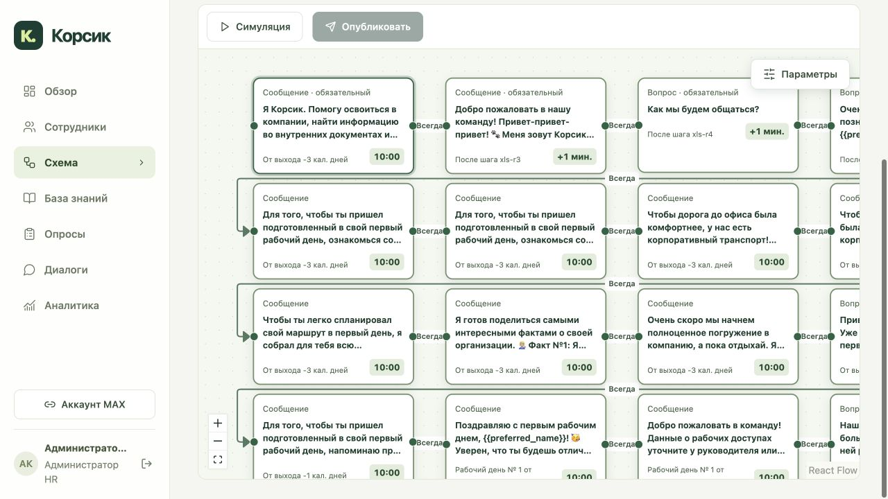
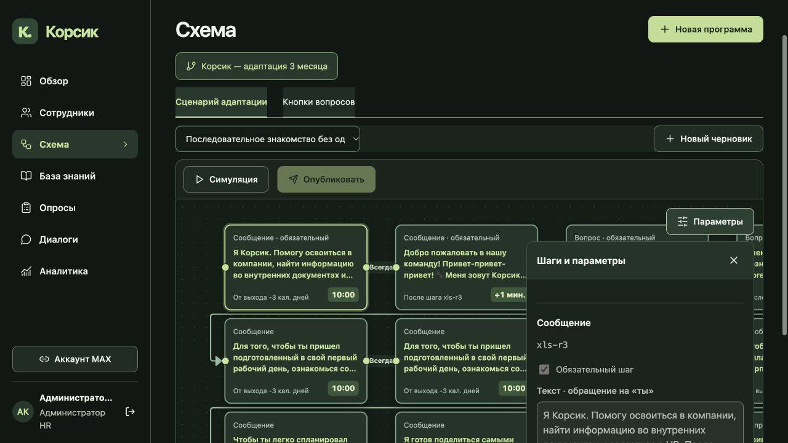

# Обновление 20: редактор схемы

Развёрнут только web-интерфейс. Проверенный публичный адрес: https://systematic-working-authorities-glenn.trycloudflare.com/scenarios. Это существующий резервный HTTPS-вход; сетевой инцидент с `app.korsik-demo.ru` этим обновлением не исправляется.

## Поведение

- Миникарта удалена; фон React Flow явно использует точки, без линий сетки.
- Карточки и стрелки получили более контрастные границы, подписи и наконечники в обеих темах. Полный текст карточки доступен в `title`; превью занимает до трёх строк. Относительное расписание выровнено влево, время выделено справа. Задержка после шага отображается как длительность, без подмены её временем суток; у сигналов нет придуманного времени.
- Кнопка «Параметры» открывает панель добавления шагов и свойств поверх схемы. Панель по умолчанию закрыта, не отнимает ширину canvas. Есть кнопка закрытия и Escape с возвратом фокуса. Масштаб и положение при переключении сохраняются.
- Canvas занимает всю доступную ширину и увеличенную высоту. Компоновка карточек сохраняет существующие координаты: ширина 260 px, в проверенной большой схеме высота 154–164 px при расстоянии между рядами 170 px.
- Исправлено мигание при редактировании: контролируемые узлы сохраняют полученные от ResizeObserver размеры. Раньше новая проекция узлов теряла `measured`, и React Flow скрывал их для повторного измерения. Кеш относится только к отображению, не записывается в сценарий и не запускает автосохранение. Настоящие изменения высоты продолжают измеряться.

Формат графа, ETag, автосохранение, симуляция, публикация и исполнение сценариев не менялись. Изменений backend, данных, моделей, токенов и сети в этом релизе нет.

## Проверка

**77/77 frontend tests PASS**, TypeScript и production build PASS, `git diff --check` PASS. Восемь тестов измерений используют установленный `adoptUserNodes` из React Flow: воспроизводят прежнюю потерю размеров и проверяют сохранение инициализации и точек соединения при вводе, выделении и перемещении. Семь дополнительных тестов проверяют расписание и разметку карточки.

Локальный стенд с отключённым MAX: большая схема из 53 узлов в обеих темах, раскрытие и Escape, последовательный ввод, изменение высоты, сохранение текста при повторном открытии и серверная симуляция из двух шагов — PASS. Исходный текст тестового черновика восстановлен.

Публичный браузер после выкладки загрузил новую точку входа, опубликованную схему из 52 узлов, обе темы и панель. Все узлы видимы, максимальная высота 164 px, миникарт 0. Canvas остаётся шириной 953 px при открытой и закрытой панели; viewport не меняется. Производственная схема при проверке не редактировалась. Нативный запуск MAX в этом прогоне не проверялся. Наблюдения браузера дополняют регрессионные тесты, но не являются измерением каждого кадра анимации. [Протокол](qa/release20-browser-verification.json).

## Развёртывание и архив

Web: `sha256:85fd5765b1812eabcd9d166a69e78c80b5120ec15049eb76ef3009df5e38197f`.
Точка входа: `/assets/index-ZyEUQvVQ.js`, SHA256 `d1c314e6e27f2c2d5607269e75cfd1eb2c58f7ca1ba31747396984e51497d316`.

Все 23 файла origin совпали со сборкой по размеру и SHA256. Web healthy, `nginx -t` PASS, maintenance marker удалён. У остальных 13 контейнеров сохранены ID и образы; backend `a18b4554…dd4e`, ACTIVE-профиль, fingerprint конфигурации и retrieval не менялись. Содержимое `.env`, Compose и nginx сохранено, включая текущую конфигурацию нового бота. [Протокол выкладки](tests/release20-web-report.json).

Архив текущих app+web образов: `/opt/korsik/offline-release20/app-web-images.tar.gz`, **273 804 592 байта**, SHA256 `1c4f133ce85dd4d4116c48edc87d3e5a63ea79e4a258c79abe5626fcbed433b7`. Проверены конфигурации обоих образов и успешный `docker load`; работающие контейнеры и теги при проверке сохранены. Старые архивы не заменены. Веса, модельные образы и runtime volumes в patch не включены; cold restore не выполнялся. [Протокол архива](tests/release20-image-patch-report.json). Приёмка компанией не проводилась.
