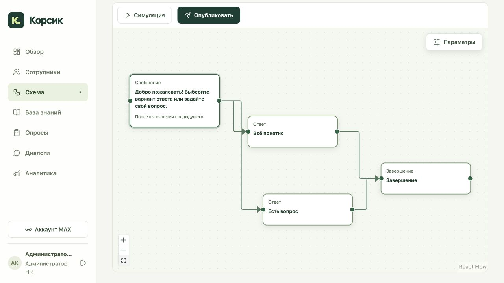

# Обновление 21: сообщения, ответы, опросы и запуск схем

Развёрнуты backend и frontend. Проверенный браузерный вход: https://systematic-working-authorities-glenn.trycloudflare.com/. Конфигурация существующего MAX-бота, сети, модели и данные базы знаний сохранены.

## Пользовательский путь

1. «Схема» открывает список карточек. «Новая схема» создаёт отдельную программу; внутри создаётся упрощённый черновик. У существующих схем предыдущего формата есть просмотр и симуляция, а кнопка «Создать упрощённый черновик» создаёт отдельную новую редакцию. Старые блоки автоматически не преобразуются и не удаляются.
2. Палитра содержит **Сообщение, Ответ, Опрос, Завершение**. Несколько стрелок «Сообщение → Ответ» создают кнопки под отправленным сообщением. Стрелка из каждого ответа задаёт его следующую ветку. Выбор сохраняется; повторное нажатие не отправляет ветку повторно. Другой вариант уже отвеченного сообщения отклоняется как устаревший.
3. «Опрос» выбирается из опубликованных опросов раздела «Опросы». Его полная версия закрепляется в сценарии, вопросы задаются последовательно. Изменение исходного шаблона не подменяет уже опубликованную программу. Один шаблон можно использовать в разных блоках без смешивания результатов.
4. В свойствах нет обязательности, аудитории шага и редактора сложных условий. ID генерируется и показывается как `ID: …`; поля его изменения нет. Расписание содержит условие, сдвиг по дням и время. У «После выполнения предыдущего» сдвиг и время отключены и не сохраняются в триггере.
5. «Настройки сценария» рядом с выбором редакции задают **При запуске / Дата выхода / По выбранному времени**. Только последний вариант показывает календарную дату и время; интерфейс явно использует время Москвы. Там же задаётся повтор незавершённого шага через 1–168 часов, по умолчанию 24.
6. У каждого сообщения можно оставить пустой список своих формулировок или добавить кнопки вопросов для RAG. В «Базе знаний» добавлена вкладка **«Основные формулировки»**. Эти вопросы всегда включаются в новое приветствие. Сохранение проверяет ETag; вопросы разрешаются по серверной версии и области сотрудника, а не по присланному клиентом тексту.

Публикация SIMPLE применяется к новым назначениям. Существующие назначения сохраняют закреплённую версию. Будущие календарные запуски после публикации автоматически назначаются подходящим подтверждённым сотрудникам с защитой от повторного запуска; прошлые даты массово не проигрываются. Запуск по началу общения фиксируется при подтверждённом старте бота или подтверждении привязки. Подробные поля и семантика — [SCENARIO-SIMPLE.md](SCENARIO-SIMPLE.md).

## Исполнение и защита от зависаний

- Сообщение продвигает сценарий после подтверждения MAX о доставке. Если подключены ответы, сценарий ждёт выбора. Последний и ожидающий блоки хранятся в journey, прогресс считает сообщения и опросы выбранной ветки.
- Повтор отправляет ожидающее сообщение с теми же вариантами либо предлагает продолжить текущий опрос. Очередь и неоднозначная доставка учитываются, повтор не размножается. Проверка непосредственно перед отправкой подавляет напоминание, если сотрудник уже продвинулся или опрос завершён.
- Паузу, прекращение найма, область доступа, человеческий диалог и смену версии проверяют при исполнении и перед отправкой. Терминальная ошибка доставки приостанавливает новый сценарий с причиной для проверки; неоднозначная доставка автоматически не повторяется.
- Текст нового сообщения ограничен 3900 символами; проверяется также результат подстановки переменных. Подписи кнопок ограничены 80 символами. Вложения новых сообщений сохраняют существующие проверки доступа. Новые материалы сценария допускаются для PREBOARDING и ACTIVE в области загрузившего HR; области старых файлов не расширялись.
- Исправлено обнаруженное ранее ожидание непринятого обращения: очередной запрос возвращается к автоматическому поиску, если обращение открыто и никем не принято. Открытое обращение сохраняется. Реальное принятие HR, владелец или `claimed_at` блокируют автоматический возврат и сохраняют человеческий диалог. Нет массовой правки действующих разговоров: проверка выполняется на следующем действии сотрудника.
- При немедленном первом сообщении новой схемы отдельное техническое приветствие подавляется. Если первый блок — опрос, завершение либо отложенное сообщение, обычное приветствие с основными формулировками остаётся.

## Проверки

**511 pytest tests + 18 subtests PASS**, **89 frontend tests PASS**, TypeScript/production build и `git diff --check` PASS. Сохранены тесты измерений React Flow, предотвращающие мигание. Один прежний DeprecationWarning Starlette не относится к функциональности обновления.

**18/18 интеграционных проверок на PostgreSQL** прошли на точном candidate image до замены production-контейнеров. Проверены подтверждение доставки, выбранная ветка, настоящая гонка двух callback, подписи/области кнопок, напоминания и stale fence, запуск по времени, полный опрос, вложения и контроль длины. Тест использовал отдельную БД только со схемой и синтетическими записями; после проверки БД удалена. Токен MAX, производственные blobs и модели в тест не подключались.

В локальном браузере собраны четыре блока и четыре связи реальным перетаскиванием, выбранная ветка проверена симуляцией, публикация проверена при отключённом MAX. Проверены календарные поля, отключённые поля после предыдущего шага, выбор опубликованного опроса, сохранение основных формулировок после повторного открытия, обе темы и изменение координат.

На опубликованном сайте проверены новая точка входа, карточки схем, существующая версия с просмотром и новая вкладка основных формулировок. Производственные схемы для проверки не публиковались, тестовых сообщений сотрудникам не отправлялось. Нативный проход в MAX на устройстве этим прогоном не подтверждается. [Браузерный протокол](qa/release21-browser-verification.json).

## Развёртывание и восстановление

Backend: `sha256:58b04354205f5c67d98930a9a5129d6fc0f57c6213942fe067aae8a594cb4afe`.
Web: `sha256:e683d5c40bf94ac589314dbe874e1066c1adf8702f89821d575eab87c1df19d0`.
Точка входа: `/assets/index-6usodJLn.js`; все 23 файла origin совпали с локальной сборкой по размеру и SHA256.

Обновлены шесть app-сервисов и web; остальные семь инфраструктурных контейнеров сохранили ID и образы. Проверены health, профиль RAG, схема PostgreSQL, Compose, nginx, окружение, текущий бот и watchdog. Maintenance marker снят. До выкладки созданы закрытые копии исходников и полный dump БД; сохранены rollback-образы. Первый preflight остановился до изменений из-за разного удаления пустых строк в сравнении `pg_dump`. Совпадение исходного DDL подтверждено, нормализация исправлена, неудачный протокол сохранён отдельно. [Протокол выкладки](tests/release21-deployment-report.json).

Архив текущих app+web образов: `/opt/korsik/offline-release21/app-web-images.tar.gz`, **273 812 413 байт**, SHA256 `4eac33316b981ea70b9423ff04ad319c304bda487a23f7718ab1cb6676373ab8`. Содержимое и `docker load` проверены; все 14 контейнеров и теги при проверке сохранились. Старые архивы оставлены. Patch не включает веса и runtime volumes; cold restore не выполнялся. [Протокол архива](tests/release21-image-patch-report.json). Приёмка компанией ещё не проводилась.
