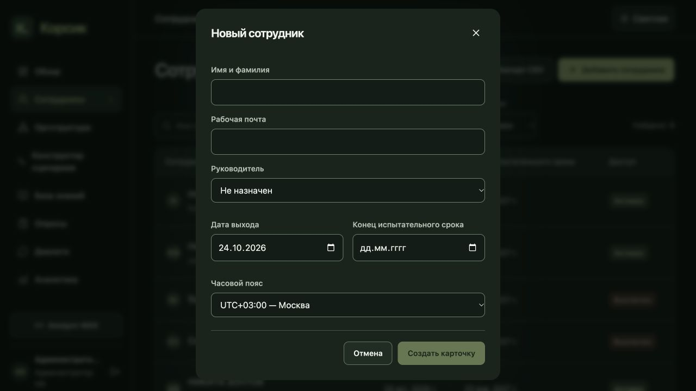

# Обновление 24: сотрудники, документы и подключение MAX

## Сотрудники

В форме создания остались имя, рабочая почта, руководитель, дата выхода, конец испытательного срока и список российских часовых поясов. Площадка, тип сотрудника, программа и ответственный HR убраны из этой формы. Сервер сохраняет совместимость со старым явным API: при упрощённом создании выбирается только разрешённая площадка, тип OFFICE, ответственный HR — создатель карточки. Неоднозначная область площадок требует уточнения через API и не расширяется автоматически.

Список показывает по 10 сотрудников. Поиск и фильтр статуса применяются перед подсчётом страниц; смена фильтра возвращает первую страницу. В карточке остаются оргструктура и подключение к MAX, сверху — даты и «Активен / Выключен». Изменения используют `If-Match`; конфликт требует явной загрузки актуальных данных.

Выключение обратимо: текущий эпизод найма, привязка MAX, ответы и история сохраняются. Доступ через кабинет, Mini App, поиск и доставку отключается. Действующие сценарии приостанавливаются; после включения пропущенные календарные сообщения не отправляются пачкой. Текущий вопрос с вариантами ответа сохраняется, напоминание ждёт полный интервал. Доставка с неизвестным исходом требует сверки. HR сохраняет управление карточкой в своей области.

## MAX

Переход по выданной HR одноразовой ссылке сразу активирует привязку. Повторного подтверждения в кабинете и сообщения об ожидании HR нет. Проверяются срок приглашения, эпизод найма, действующие полномочия издателя и отсутствие другой активной привязки этого аккаунта MAX. Конфликтующие старые привязки автоматически не переносятся.

## База знаний

Загрузка принимает один файл. Вместо площадок выбираются подразделения из оргструктуры; «Доступен всем» отключает выбор подразделений и сохраняет ограничения области HR. Выбранное подразделение включает актуальные дочерние команды. Перевод сотрудника, изменение дерева и выключение доступа учитываются по текущим данным PostgreSQL без переиндексации. Метаданные индекса не являются источником полномочий.

Поля срока действия и описания изменений убраны из формы. В редакторе остаются версии, оригинал, просмотр страниц и распознанного содержимого, исправления, замена файла и публикация. Индексация выполняется автоматически. Действующий опубликованный файл сохраняется до успешной публикации замены.

Текстовый баннер над созданием опроса убран. Правила доступа к результатам и подтверждения участия в самом опросе сохранены.

## API

| Метод | Путь после `/api/v1` | Назначение |
|---|---|---|
| GET | `/employees?page=1&page_size=10&search=...&stage=...` | Сотрудники, итог и число страниц |
| PATCH | `/employees/{id}/administration` | `enabled`, даты, часовой пояс; `If-Match` |
| POST | `/knowledge/documents` | `audience_all` и `scope.org_unit_ids`; область HR задаёт сервер |
| POST | `/knowledge/documents/{id}/revisions` | Один файл, `simple_workflow=true` |
| GET | `/knowledge/revisions/{id}/simple-status` | Состояние обработки и причины блокировки публикации |
| POST | `/knowledge/revisions/{id}/simple-prepare` | Автоматическая подготовка существующей редактируемой версии |
| POST | `/knowledge/revisions/{id}/simple-publish` | Явная публикация показанной версии; `If-Match` |

Старые расширенные API документов сохраняют прежний режим и проверки. Миграции схемы БД не требуются: дополнительные признаки хранятся в JSON существующих сущностей.

## Проверки

642 серверных теста и 18 subtests, 156 тестов интерфейса, TypeScript/Vite и проверка diff прошли. На точных кандидатных образах прошли 90/90 проверок PostgreSQL без пропусков: гонки привязки MAX и публикации, выключение доступа, актуальная оргструктура, замена документа, повторы и сохранность старых сценариев. Временная БД удалена. Первые отказы операторского стенда были связаны с правами чтения тестового файла и HTTPS cookie в тестовом клиенте; приложение для обхода этих проверок не менялось. OpenAPI: 223 пути, 270 операций; JSON и YAML сформированы из приложения.

[Локальный протокол](tests/release24-local-browser-report.json) фиксирует создание, страницы 10/4, выбор часового пояса, даты, OFF/ON, доступ по подразделению, автоматическую подготовку документа, явную публикацию и замену с сохранением старой действующей версии. Тестовые сотрудники и документы созданы только на локальном стенде с отключённым MAX.

Изменение организационных прав меняет идентичность кода поиска. Поэтому старый AI-профиль и старый отчёт качества не переобозначаются как проверенные для нового кода. Для текущего кода заново выполнены 29 основных и 10 вопросов без источников на реальных локальных моделях, с read-only доступом к опубликованному корпусу. Независимая проверка всех 39 ответов по 117 закреплённым фрагментам на 33 страницах прошла: 24 цитатных ответа, 2 генерации и 13 передач специалисту. Веса, модели и параметры генерации сохраняются; обновлению подлежит только проверенная идентичность кода и отдельный нативный профиль. Это ограниченная инженерная проверка, не приёмка произвольных ответов компанией. [Отчёт качества](tests/model-quality/qwen-4b-release24.json).

## Выкладка и итоговый чекпоинт

Версия 24 работает на https://app.korsik-demo.ru/. Переключение заняло 97,097 секунды; режим обслуживания снят. После выкладки работают 14 сервисов, все 13 предусмотренных healthcheck проходят. Семь инфраструктурных контейнеров сохранены. Схема PostgreSQL, настройки сети, токен и webhook MAX, веса моделей и параметры генерации не менялись. Первая попытка остановилась на предварительной проверке старых завершённых контейнеров инициализации; фильтр служебной проверки исправлен до переключения. Разрешены только два известных завершённых setup-контейнера, остальные неожиданные состояния блокируют выкладку.

| Артефакт | Точное значение |
|---|---|
| App image | `sha256:ce57b035cbb96aaad488e2b30e08bcdb7130f31168049f838e35e00986af2adc` |
| Web image | `sha256:a4268e24d4a9e3fb4ab61aecb237e28b9df5620ed2ac9ddae57cefe0ef6af67b` |
| Web entry | `/assets/index-DmWW3DbD.js` |
| Новый активный AI-профиль | `052c5a64-ac05-4286-a4c0-18e3fb1e77dc` |
| Нативная проверка | `b50dc0a6-3651-4fe9-8115-3cd9486a752a`, PASSED / FULL_READY |
| Quality24 SHA256 | `df11daefc64ec6cb71d8876694294a64c2391573acbe3494f07cd63eeee81795` |

Новый профиль прошёл настоящую проверку идентичности кода и моделей, embedding/reranking и три пробные генерации. Старый профиль и его конфигурация сохранены. Публичная HTTPS-проверка подтвердила побайтовое совпадение всех 28 файлов с проверенной сборкой и контракт OpenAPI 223/270. В браузере на публичном адресе проверены формы сотрудника, даты и доступ, один файл, переключатель подразделений и опросы без баннера. Данные сотрудников и документы при этой проверке не менялись; функциональные операции проверены на изолированных данных. В текущей публичной оргструктуре доступных подразделений нет — заполненный выбор проверен на локальном стенде.

Серверный архив `/opt/korsik/offline-release24/app-web-images.tar.gz` содержит ровно два текущих образа: **273831805 байт**, SHA256 `e08cf716445ac36555b7ac8ae92e0a60d292b56efc181417b41516323fe37a96`. Рядом сохранены точный quality24 и его доказательства, manifest, SHA256SUMS и инструкция INSTALL. При восстановлении нужно устанавливать этот quality24 и выполнять нативную проверку/активацию профиля; старый отчёт не соответствует новой идентичности поиска. Проверка `docker load` прошла без изменения работающих контейнеров и тегов. Старые архивы сохранены. Полное холодное восстановление и запуск Mini App на устройстве MAX в этой выкладке не проверялись.

Протоколы: [PostgreSQL](tests/release24-staging-report.json), [выкладка](tests/release24-deployment-report.json), [публичный HTTPS](tests/release24-public-readonly-report.json), [публичный браузер](tests/release24-public-browser-report.json), [итоговое состояние](tests/release24-final-runtime-readonly-report.json), [образы и quality companion](tests/release24-image-patch-report.json).

