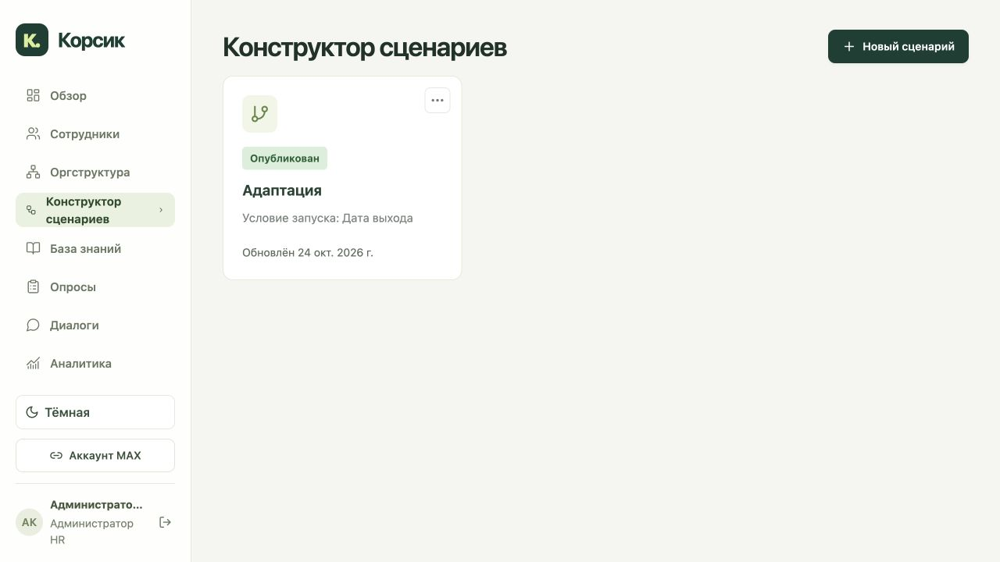
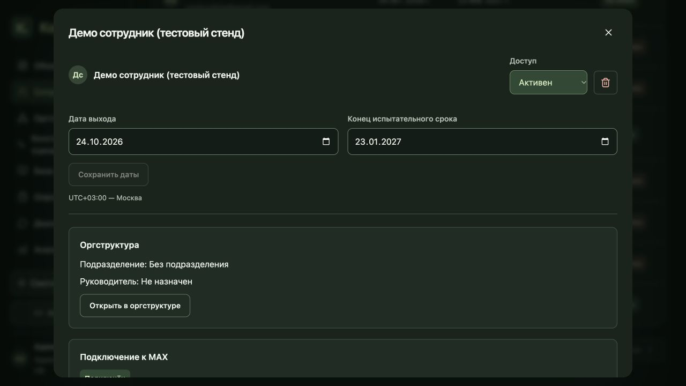

# Обновление 25: удаление сотрудника и меню

В карточке сотрудника рядом со статусом добавлено удаление. Действие требует подтверждения выбранного имени и актуального `If-Match`, доступно HR в своей области. Карточка исчезает из обычных списков; доступ сотрудника выключается, приглашения и привязки MAX отзываются, запланированные отправки останавливаются. История найма, диалогов и ответов сохраняется. Уже начатые отправки с неизвестным исходом остаются для сверки.

Удаление логическое. API восстановления оставляет доступ выключенным и не оживляет прежние ссылки, сессии и привязки. Отдельные полномочия учётных записей HR не удаляются вместе с карточкой занятости.

Верхняя полоса с повторяющимся названием раздела удалена из авторизованного кабинета. Переключатель светлой и тёмной темы перенесён в левое меню; выбранная тема сохраняется прежним механизмом. На узком экране меню открывается отдельной компактной кнопкой.

| Метод | Путь после `/api/v1` | Назначение |
|---|---|---|
| DELETE | `/employees/{id}` | Логическое удаление, `If-Match` |
| POST | `/employees/{id}/restore` | Восстановление карточки с выключенным доступом, `If-Match` |

## Проверки

Полный серверный набор: 662 теста и 18 subtests; интерфейс: 162 теста; TypeScript/Vite и проверка diff прошли. OpenAPI сформирован из приложения: 224 пути и 272 операции. В 20 новых серверных проверках покрыты права и версии, скрытие карточки, сессии и MAX, очереди доставки, сохранение истории и восстановление с выключенным доступом.

В локальном браузере проверены создание временной синтетической карточки, отмена и подтверждение удаления, закрытие карточки, обновление списка 15→14, положение кнопки и темы, отсутствие верхней полосы и сохранение темы после перезагрузки. База сохраняет статус DELETED, выключенный доступ и прежний эпизод найма. Реальные сотрудники не изменялись. [Протокол интерфейса](tests/release25-local-browser-report.json), [общие проверки](tests/release25-validation-report.json).

Удаление не ждёт занятые транспортом строки очереди в обратном порядке блокировок. Старые отправки дополнительно ограничены моментом удаления и не оживают после восстановления карточки. На точных кандидатных образах прошли 114/114 проверок PostgreSQL без пропусков, включая четыре конкурентных проверки удаления, подключения MAX, восстановления и занятой строки очереди. Временная БД удалена; тестовые записи и сообщения MAX в рабочую БД не добавлялись. [Протокол PostgreSQL](tests/release25-staging-report.json).

## Выкладка

Обновление работает на https://app.korsik-demo.ru/. Переключение заняло 27.028 секунды, режим обслуживания снят. Все 14 сервисов работают; все 13 предусмотренных healthcheck проходят. Семь инфраструктурных контейнеров сохранены. Использованы точные образы, прошедшие PostgreSQL-проверку, без повторной сборки.

| Артефакт | Точное значение |
|---|---|
| App image | `sha256:cfffe35fc7dbf514ff1f8cbf3cc7a82c7e466a1d3065fefa2ad22eea455086bd` |
| Web image | `sha256:e9c324b2ddf5fd19cb9a9858e45efb8ce6aa874f2fd4bd3562a8d4121f0cbf16` |
| Web entry | `/assets/index-CsonFU7E.js` |
| Сохранённый AI-профиль | `052c5a64-ac05-4286-a4c0-18e3fb1e77dc` |

Идентичность кода поиска, quality24, конфигурация активного профиля и FULL_READY сохранены. Новая проверка генерации и переактивация профиля не выполнялись: поиск и модели не менялись. Схема БД, настройки сети и MAX, веса и параметры генерации сохранены. Перед переключением сохранены закрытые резервные копии исходников и БД, а также предыдущие образы. Откат в рабочей среде не запускался.

[Протокол выкладки](tests/release25-deployment-report.json), [публичный HTTPS](tests/release25-public-readonly-report.json).

В публичном браузере после перезагрузки проверены кнопка рядом со статусом, открытие и отмена подтверждения, отсутствие верхней полосы, тема в меню и сохранение выбора после перезагрузки. Исходная тема возвращена. Удаление реального сотрудника не выполнялось. [Протокол браузера](tests/release25-public-browser-report.json).

Итоговые проверки подтвердили 27 файлов публичного интерфейса, OpenAPI 224/272, FULL_READY и неизменность действующего профиля и quality24. [Итоговое состояние](tests/release25-final-runtime-readonly-report.json), [архив образов](tests/release25-image-patch-report.json).

Архив `/opt/korsik/offline-release25/app-web-images.tar.gz`: **273837609 байт**, SHA256 `1e5fe2e37488004ba28ce232a9d7a1539b09afd34e42116613dad069c0a2b8e2`. Содержит только два текущих образа. Рядом сохранены прежний точный quality24, manifest, SHA256SUMS и инструкция INSTALL. `docker load` прошёл; работающие контейнеры, теги и старые архивы, включая release24, сохранены. Веса и runtime-тома в этот архив не включены. Полное холодное восстановление и запуск Mini App на устройстве MAX для этой версии не проверялись.

