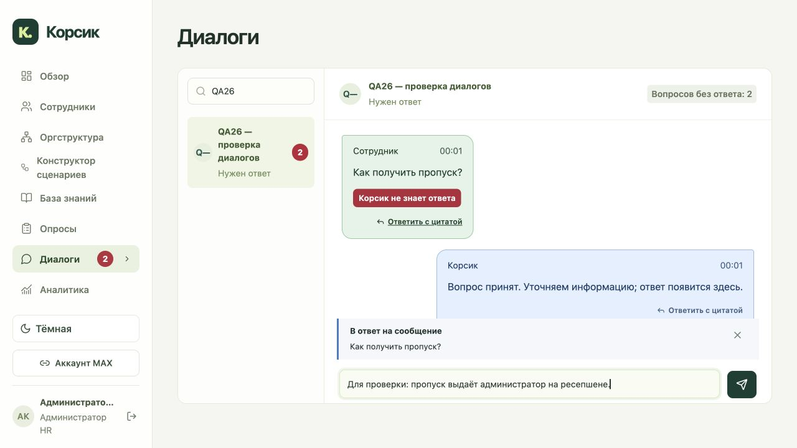
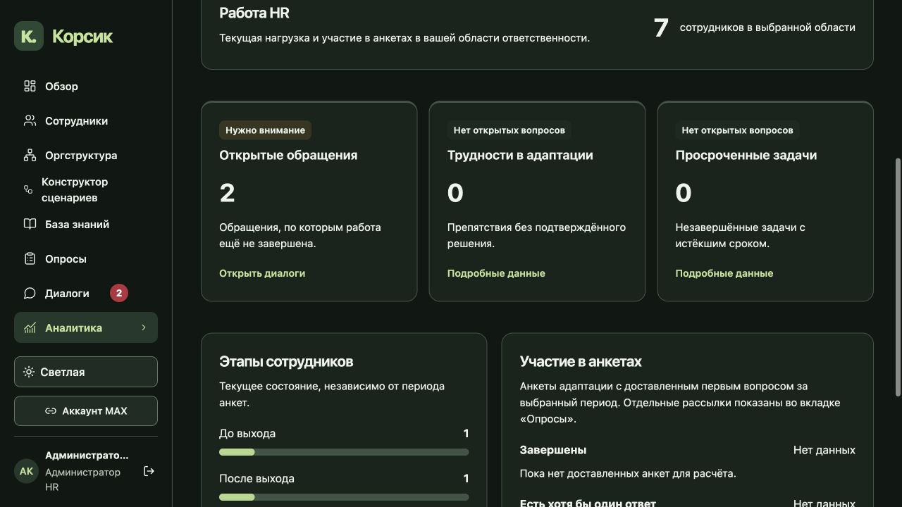

# Обновление 26: опросы, диалоги, аналитика и свободные ответы

## Опросы

Из редактора убраны пояснение сотруднику, сообщение после завершения и основание действия. Исторические значения существующей версии сохраняются. Вопросы перемещаются стрелками вверх и вниз, крайние направления блокируются. Сохранение называется «Сохранить». Версии, проверки доступа и добровольность участия сохраняются.

## Диалоги

Сообщения сотрудника расположены слева зелёным, Корсика — справа синим. Можно выбрать сообщение для ответа с цитатой. HR отвечает сразу из поля ввода; отдельное предварительное подключение не требуется. Явное назначение другому HR защищено от перехвата.

В HR-интерфейсе исходный вопрос, оставшийся без ответа Корсика, помечается красным «Корсик не знает ответа». Список показывает число нерешённых вопросов каждого диалога, а меню — число проблемных диалогов. Ответ на выбранный проблемный вопрос снимает ровно его отметку; произвольное сообщение HR не закрывает все вопросы сразу. Счётчики выводятся из сохранённой истории без записи при чтении.

## Аналитика

Добавлены понятные представления для HR, руководителя HR и руководителя команды: кому нужна помощь, ход адаптации, участие в опросах и сравнение площадок в пределах полномочий. Текущая нагрузка отделена от событий выбранного периода. Подробные таблицы раскрываются отдельно, CSV сохранён. Пустые данные и закрытые малые группы не превращаются в выдуманные показатели.

## Сценарии

У блока «Ответ» появился «Свободный ответ». После выбора Корсик пишет: «Дай, пожалуйста, ответ в свободной формулировке.» Следующий текст сохраняется в истории и сценарии, затем продолжается выбранная ветка. Этот текст не запускает поиск по базе знаний. Проверяются актуальный шаг, эпизод, контекст, дубли и устаревшие напоминания. Базовые формулировки добавляются ко всем SIMPLE-сообщениям с сохранением вариантов ветвления и пользовательских формулировок.

## Диагностика коммерческой тайны

У двух последних реальных отказов причина `NO_PUBLISHED_APPLICABLE_SOURCES`: сотрудник в PREBOARDING, опубликованный документ разрешён только ACTIVE. Это отказ по аудитории до обращения к модели. Пользователь явно выбрал оставить документ только работающим сотрудникам. Этот допуск сохранён; PREBOARDING по-прежнему не получает документ.

Отдельно выполнены три read-only запроса для действующего сотрудника с разрешённым доступом. Определение вернуло источники со страниц 3 и 5 за 6,073 секунды. Общий запрос попытался вызвать генерацию, достиг лимита 17 секунд и завершился цитатным ответом за 23,611 секунды. Утверждать, что свободная генерация исправлена, на этой основе нельзя. Стандартная кнопка «Коммерческая тайна» теперь задаёт вопрос об определении вместо узкого вопроса о паролях; версия стандартного меню изменена честно, настройки HR сохранены.

[Диагностический отчёт](tests/release26-rag-diagnosis-report.json) содержит измерения и план следующего сравнения качества. Поиск, веса, настройки и активный AI-профиль в рамках диагностики не менялись.

## Проверки и публикация

Обновление опубликовано на https://app.korsik-demo.ru/. Контрольный commit реализации: `9ea1fab1765d9025d38b31633d4b75eeba7a0442`. Локально прошли 689 backend-тестов и 18 subtests, 183 frontend-теста, TypeScript и Vite. На точном образе отдельно прошли 144 проверки PostgreSQL без пропусков: в том числе одновременный ответ двух HR, повтор одного запроса и дубли выбора/текста свободного ответа. Временная база удалена.

Локальный интерфейс проверен на синтетических данных: вопросы диалога уменьшаются 2 → 1 → 0, глобальный счётчик диалогов 2 → 1; ответы содержат выбранную цитату. Стрелки опроса сохраняют тексты, форма сохраняется. Симуляция свободного ответа сначала ожидает текст и затем продолжает ветку. На опубликованном сайте проверены навигация, новая форма без сохранения и дашборды; реальные HR-ответы и MAX-сообщения для этой проверки не отправлялись.

Развёрнуты заранее проверенные образы без повторной сборки:

- app: `sha256:062abf9c159001182f602d2d36a115d37d51bb4948a8bd968d99433e03451da2`
- web: `sha256:379dd6d34c7ff15f0241442f7aac5e9d4ebbbb575770f097693b5cf84ad1906c`
- entry: `/assets/index-BHgnhYVC.js`

Перерыв при переключении составил 26.724 секунды. Итог: 14 сервисов работают, 13 проверок здоровья успешны, Qdrant без отдельной healthcheck, FULL_READY, режим обслуживания снят. HTTPS проверил все 29 файлов и OpenAPI 225 путей / 273 операции. Активный AI-профиль, качество24, параметры генерации и схема базы остались прежними.

Офлайн-архив точных app/web образов на сервере: `/opt/korsik/offline-release26/app-web-images.tar.gz`, 273845065 байт; SHA256 `6a028f0f3219e7336ab1030b113f493a0eb77c70cd68e374832c6faa1153dec2`. Повторная загрузка Docker прошла без изменения работающих контейнеров и тегов. Исторические архивы сохранены. Это проверка загрузки образов, не новое восстановление полного стенда с нуля.

[Проверки](tests/release26-validation-report.json) · [PostgreSQL и staging](tests/release26-staging-report.json) · [Выкладка](tests/release26-deployment-report.json) · [HTTPS](tests/release26-public-readonly-report.json) · [Работающий стенд](tests/release26-final-runtime-readonly-report.json) · [Архив образов](tests/release26-image-patch-report.json) · [Локальный браузер](tests/release26-local-browser-report.json) · [Опубликованный интерфейс](tests/release26-public-browser-report.json)

