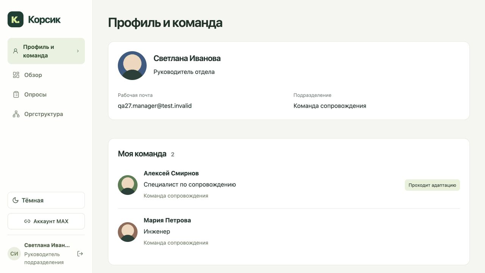
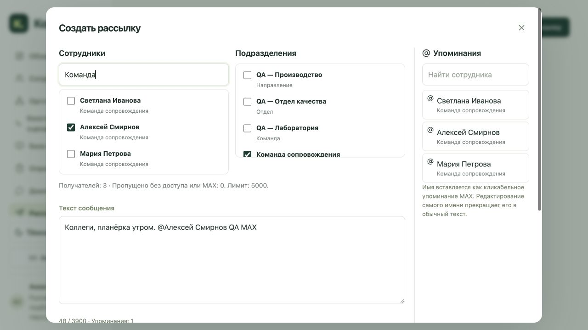
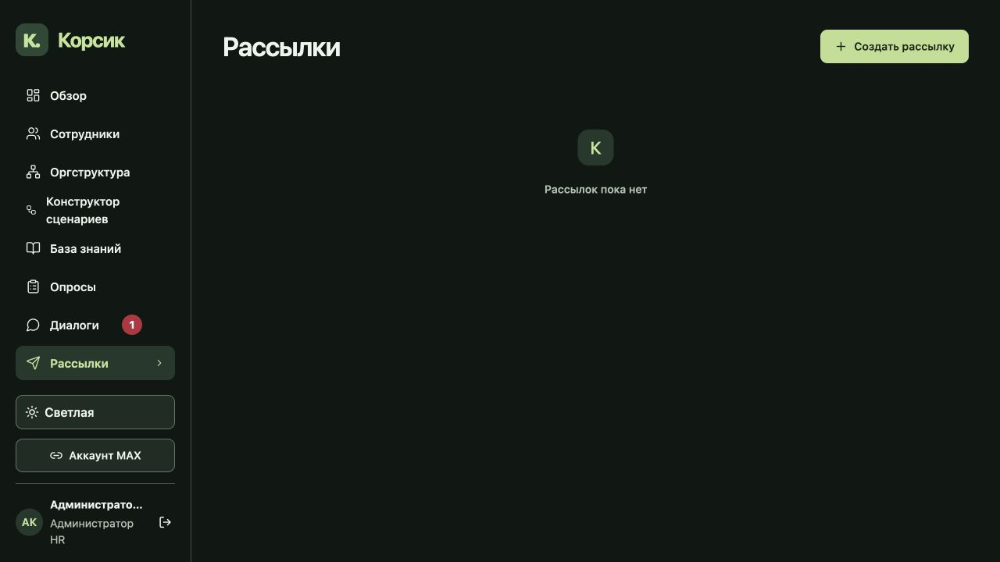

# Обновление 27: профили миниапа, приглашения HR и рассылки MAX

## Профили и роли

У сотрудника первой страницей стал «Мой профиль»: фотография, ФИО, почта, подразделение, руководитель с фотографией, дата выхода и конец испытательного срока. У руководителя подразделения — «Профиль и команда»: собственные данные и прямые подчинённые с фотографиями. Отметка «Проходит адаптацию» берётся из действующей программы текущего периода найма, а не из одной даты выхода.

Связи руководителей учитывают оргструктуру и явное подчинение. Отсутствующие данные обозначаются честно. Фотографии выдаются через узкий авторизованный маршрут: свой профиль, действующий руководитель и собственная команда. Проверяются текущий период найма, доступность сотрудника, свежая запись файла и принадлежность валидированного изображения. Ширина 390px проверена отдельно; фотографии и имена не сжимают друг друга.

Существующий кабинет HR сохранён. «Руководитель по подбору персонала» (`HEAD_TALENT`) получает права HR-менеджера (`HR_SPECIALIST`) в своей области, работу с подразделениями и новый раздел «HR-менеджеры». Роль остаётся серверной: названия должностей, иерархия сотрудников и текст MAX не назначают привилегии. Административные действия, ранее доступные только `HR_ADMIN`/`PLATFORM_ADMIN`, не делегируются новой ролью.

## Приглашения HR

Руководитель подбора и администратор HR создают приглашение по имени и рабочей почте. Одноразовая ссылка выдаётся при создании и подключает нового HR через подписанный запуск миниапа MAX. Создаётся только `HR_SPECIALIST`; область не превышает текущие полномочия приглашающего. Ссылка по умолчанию действует сутки и может быть отозвана.

При использовании повторно проверяются роль, включённость и область автора. Существующая привязка MAX или занятая почта не превращаются в повышение чужого аккаунта. Создание пользователя, привязки, погашение приглашения и сессия выполняются атомарно. В списках сохраняются статусы и сроки; исходный токен повторно не выдаётся. Функция не отправляет приглашение человеку автоматически.

## Аналитика

Убраны «Подробные данные», таблицы, связанные действия и скрытая загрузка прежних подробных разделов. Понятные дашборды и CSV сохранены. Для руководителя подбора показаны частые проблемы: реальные темы обратной связи, подтверждённые HR, с фильтрами периода и области. Неподтверждённые темы и группы менее пяти сотрудников не раскрываются; пустота не выдаётся за отсутствие проблем.

## Рассылки MAX

Новый раздел «Рассылки» доступен HR и руководителю подбора. В простой форме можно выбрать несколько сотрудников и подразделений с вложенными командами, написать текст, вставить упоминания из списка справа, выбрать дату, время и российский часовой пояс.

Люди и подразделения объединяются без дублей. Состав фиксируется при создании, максимум 5000 получателей; новые участники команды не добавляются в старую рассылку автоматически. Очередь формируется порциями по 100 через существующий outbox/коннектор. Перед доставкой повторно проверяются область автора, включённость сотрудника, период найма, его MAX и принадлежность выбранному подразделению. Исчезнувший из выбора получатель удаляется отдельным действием без потери текста формы.

Упоминания — нативные ссылки MAX, сформированные сервером из разрешённых сотрудников и текущих привязок. Пользовательский HTML экранируется; произвольный MAX ID нельзя передать через форму. [Форматирование сообщений MAX](https://dev.max.ru/docs-api/use-cases/sending-messages/text-formatting).

«В ожидании» сменяется на «Исполнено» после подтверждения MAX для всех допустимых получателей. Ошибки, пропуски и неподтверждённый результат видны отдельно; неопределённую доставку система не повторяет автоматически. При удалении сотрудника его строка истории маскируется; потеря области доступа по-прежнему закрывает запись рассылки.

## Проверки

733 backend-теста и 18 subtests, 205 frontend-тестов, TypeScript/Vite и проверка diff прошли. OpenAPI: 233 пути / 283 операции. Локально проверены профили двух ролей, фотографии, адаптация, создание подразделения, приглашение HR и рассылка на трёх получателей с календарём и упоминанием. Это синтетические данные; реальные сообщения и новые производственные аккаунты для проверки не создавались. Проверка 390px относится к браузерной вёрстке; запуск на реальном устройстве MAX этим не заявляется.

[Проверки сборки](tests/release27-validation-report.json) · [Локальный браузер](tests/release27-local-browser-report.json)

## Выкладка

Обновление установлено на [рабочем сайте](https://app.korsik-demo.ru/). До переключения точные серверные образы прошли 197 из 197 проверок PostgreSQL без ошибок и пропусков; временная база удалена. Проверены конкурентное погашение HR-приглашений, отзыв и изменение области автора, свежесть прав на фотографии, повторное создание рассылки и одновременная работа планировщиков. Предыдущие сценарии, удаления сотрудников и диалоги также прошли сохранённые интеграционные проверки.

Установлены именно проверенные образы, без повторной сборки:

- app: `sha256:35ead025c80d05ea57c261cb28b3f10a001890882ee1abd7a81cd0f609afdb70`
- web: `sha256:83c28de733d508b356477f3bc934d6052a8dd14144dde4c9c693e1fee509f131`
- входной файл: `/assets/index-CMo0xNax.js`.

Переключение заняло 27.544 секунды. Итог: 14 работающих контейнеров, 13 успешных healthcheck, `FULL_READY`; технический режим выключен. Через публичный HTTPS проверены все 33 файла с совпадением SHA-256 и OpenAPI 233/283. В браузере подтверждены новые разделы, формы и отсутствие подробных данных аналитики. Производственные HR-приглашения, аккаунты и рассылки для этой проверки не создавались.

Инкрементальный архив образов на сервере: `/opt/korsik/offline-release27/app-web-images.tar.gz` — 273854297 байт, SHA-256 `57b03e6528edb84e6dbf83c50a9f6d16e79aec5678e649b2c61451df65e033f1`. Проверка `docker load` завершилась успешно; загружены только два текущих образа, работающие контейнеры и теги не изменились. Предыдущие архивы сохранены. Архив не включает веса моделей и тома данных; полное восстановление с нуля не заявляется.

Действующий профиль генерации, retrieval и доказательства качества release24 сохранены; новая активация модели и повторная семантическая оценка в этом обновлении не выполнялись. Допуск к коммерческой тайне остаётся только для работающих сотрудников.

[PostgreSQL и подготовка](tests/release27-staging-report.json) · [Выкладка](tests/release27-deployment-report.json) · [Публичный HTTPS](tests/release27-public-readonly-report.json) · [Публичный браузер](tests/release27-public-browser-report.json) · [Итоговое состояние](tests/release27-final-runtime-readonly-report.json) · [Архив образов](tests/release27-image-patch-report.json)

