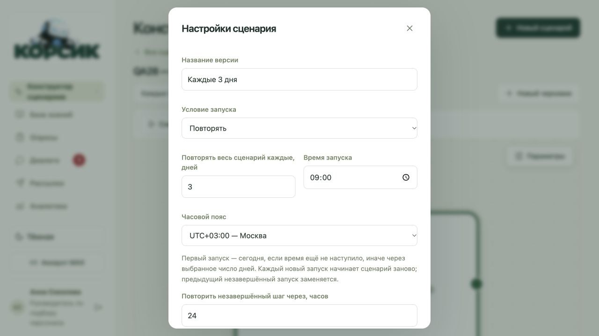
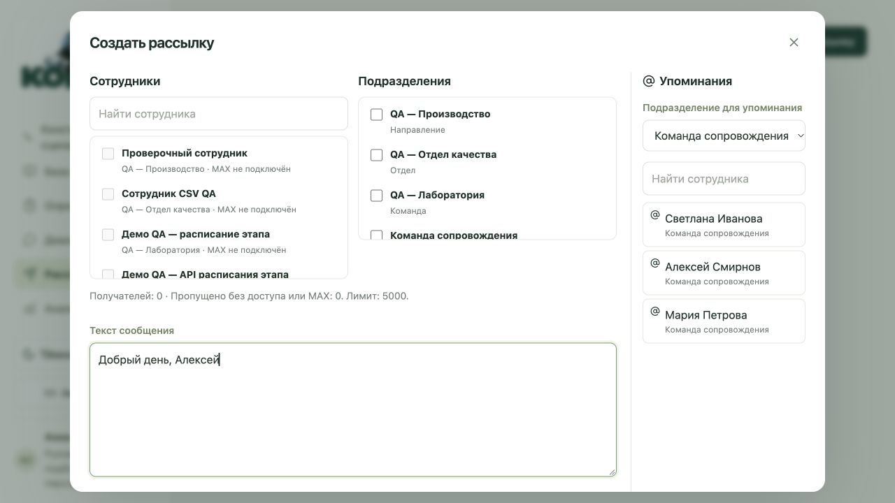
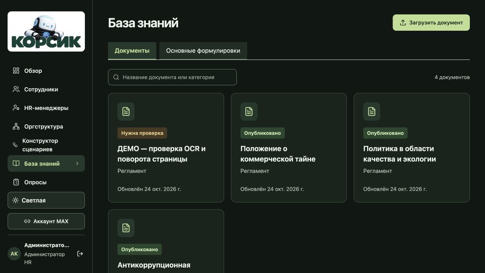

# Обновление 28 — чек-лист замечаний

- [x] 1. Из базы знаний убраны вкладка «Контрольные вопросы» и её загрузка. Оставлены документы и основные формулировки.
- [x] 2. Основные формулировки и глобальные кнопки не добавляются к сообщениям сценария. Исправлены и ранее поставленные в очередь кнопки; текст сценария, его ответы и собственные формулировки сохраняются. Меню свободного диалога работает отдельно.
- [x] 3. Кнопки аккаунта MAX одинаковой высоты и ширины, между ними есть отступ.
- [x] 4. В сообщении сценария можно выбрать несколько файлов за один раз, до 10 материалов.
- [x] 5. Добавлена галерея: предоставленный Корсик и доступные ранее загруженные изображения. Выбранное изображение становится проверенным внутренним вложением. Материалы теперь доходят также в сообщения старых календарных схем.
- [x] 6. Предоставленный PNG установлен в меню и на экране входа без изменения изображения.
- [x] 7. В настройках SIMPLE-сценария есть «Повторять»: каждые N дней, время и часовой пояс.
- [x] 8. Название и настройки сохраняются одной кнопкой «Сохранить изменения» снизу справа. «Удалить» находится снизу слева.
- [x] 9. Опросы имеют действия «Сохранить» и «Опубликовать». Карточки показывают «Опубликованный» или «Неопубликованный». Сохранены выбор версии и создание черновика из выбранной версии. Опубликованная версия доступна сценарию даже при наличии нового черновика.
- [x] 10. На главной странице опросов оставлены создание и список. Заголовок «Рассылки и результаты» и пустой блок убраны; реальные результаты доступны внутри соответствующего опроса.
- [x] 11. Обращение в рассылке вставляется обычным текстом из предпочитаемого имени сотрудника, без MAX-ссылки и без требования привязки MAX у упоминаемого человека. Справа есть фильтр по подразделению с вложенными командами. Под именами показывается актуальное подразделение. Нижние пояснения убраны. Выбор подразделений получателей сохранён отдельно.
- [x] 12. Удаление доступа HR доступно только руководителю подбора персонала в своей области. Отзываются сессии, привязки и приглашения; история сохраняется. Себя, установочный аккаунт и другие административные роли удалить этим действием нельзя.
- [x] 13. Только на пустой первичной установке создаётся скрытый `admin/admin` с ролью руководителя подбора. До работы требуется изменить логин и пароль. Аккаунт отсутствует в списках; после настройки ему доступна кнопка «Логин и пароль». Повторное развёртывание не сбрасывает и не повышает существующие аккаунты.
- [x] 14. «HR-менеджеры» перенесены сразу под «Сотрудники».
- [x] 15. В оргструктуре есть отдельное действие «Сделать руководителем». Оно меняет доступ к миниапу, сохраняя карточку, MAX, период найма и историю. Назначение непосредственного руководителя остаётся отдельным действием. HR и административные роли этим действием не меняются.

Повтор всего сценария отделён от напоминаний о незавершённом шаге. Первый запуск назначается на ближайшее выбранное время; следующие сохраняют календарный интервал. После простоя создаётся один актуальный запуск без пачки пропущенных сообщений. Новый период заменяет предыдущий незавершённый повтор с явной причиной отмены; неопределённая доставка требует проверки. Прежние календарные схемы сохраняют свой формат.

Загрузка вложений привязана к исходному блоку и актуальному графу: завершение загрузки после переключения блока не возвращает старый граф и не затирает новые правки. Опубликованные версии опросов и уже назначенные версии не редактируются на месте.

Проверки: 775 backend-тестов и 18 subtests, 229 frontend-тестов, TypeScript/Vite, OpenAPI 238 путей / 289 операций. В браузере проверены 19 действий на синтетических данных с готовой frontend-сборкой. Сохранение/публикация опроса, новый черновик, сохранение повторов и импорт картинки выполнены локально. Диалоги удаления HR и выдачи роли открыты и отменены; реальные переходы проверены автоматическими контрактами. Производственные аккаунты, пароли и сообщения для QA не менялись; запуск на реальном устройстве MAX не заявляется.

[Общие проверки](tests/release28-validation-report.json) · [Локальный браузер](tests/release28-local-browser-report.json)

## Выкладка

Обновление установлено на [рабочем сайте](https://app.korsik-demo.ru/). Точные образы до переключения прошли **246/246 PostgreSQL-проверок**, без ошибок и пропусков. Проверены конкурентные публикации и создание черновиков, смена реквизитов, отзыв доступа HR, роли миниапа, одноразовые ссылки и повтор сценария. Временная база удалена.

- app: `sha256:5d976d9f6a85262eaa99f20d4ede24fa0bcbd230949076e1e56cb9804343e8d0`
- web: `sha256:4cd407a4ac7f0d8d1f2b1cfafbf0a2969bc7a2553ac4f0e8b58c08f6000a1b9f`
- входной файл: `/assets/index-DNK7eQur.js`.

Переключение заняло 26.947 секунды. Работают 14 контейнеров, 13 healthcheck успешны, `FULL_READY`; технический режим выключен. Все 36 файлов публичного HTTPS совпадают с готовой сборкой. В рабочем браузере проверены 8 пунктов без сохранений и изменения данных.

Существующие логины, пароли, роли и настройки сервера при выкладке не менялись. Скрытый `admin/admin` предназначен для будущей пустой установки; в работающей базе дополнительный аккаунт с этим паролем не создаётся. Модели, RAG, профиль генерации, quality24 и схема БД сохранены. Допуск к коммерческой тайне остаётся только для работающих.

Архив двух текущих образов: `/opt/korsik/offline-release28/app-web-images.tar.gz`, 275596661 байт, SHA-256 `5d124e1f1bb4c709640ce7858e02190efb98af239b0bef6d90c01c1b204949df`. `docker load` завершился успешно, контейнеры и теги после проверки совпадают с состоянием до неё. Предыдущие архивы сохранены; веса моделей и тома данных в этот патч не входят, полное восстановление с нуля не заявляется.

[Подготовка и PostgreSQL](tests/release28-staging-report.json) · [Выкладка](tests/release28-deployment-report.json) · [Публичный HTTPS](tests/release28-public-readonly-report.json) · [Публичный браузер](tests/release28-public-browser-report.json) · [Runtime](tests/release28-final-runtime-readonly-report.json) · [Архив образов](tests/release28-image-patch-report.json)

